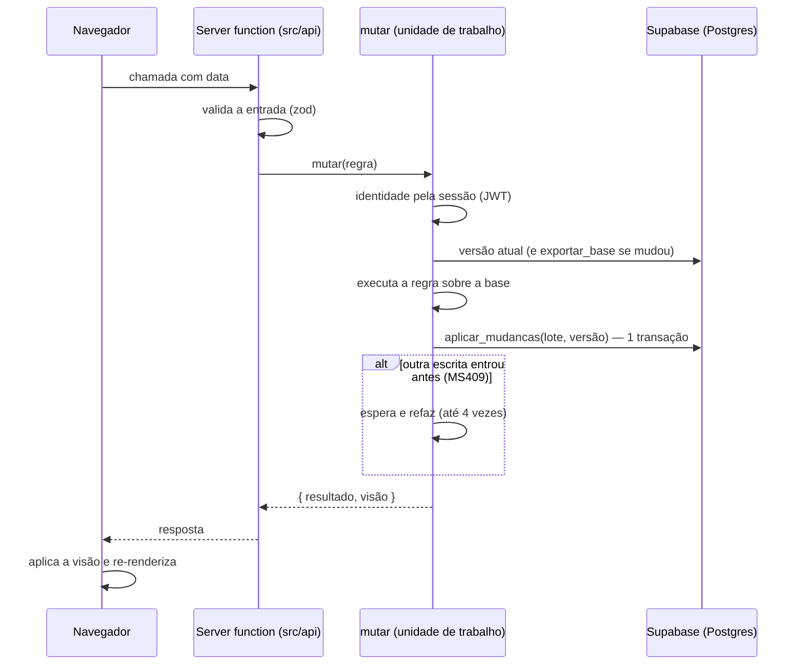
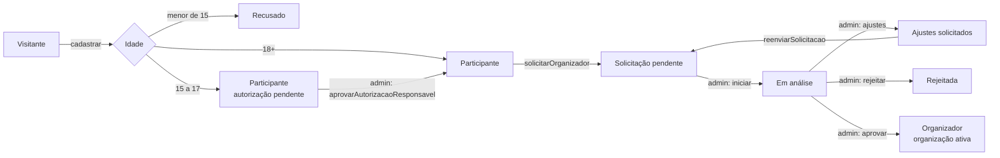
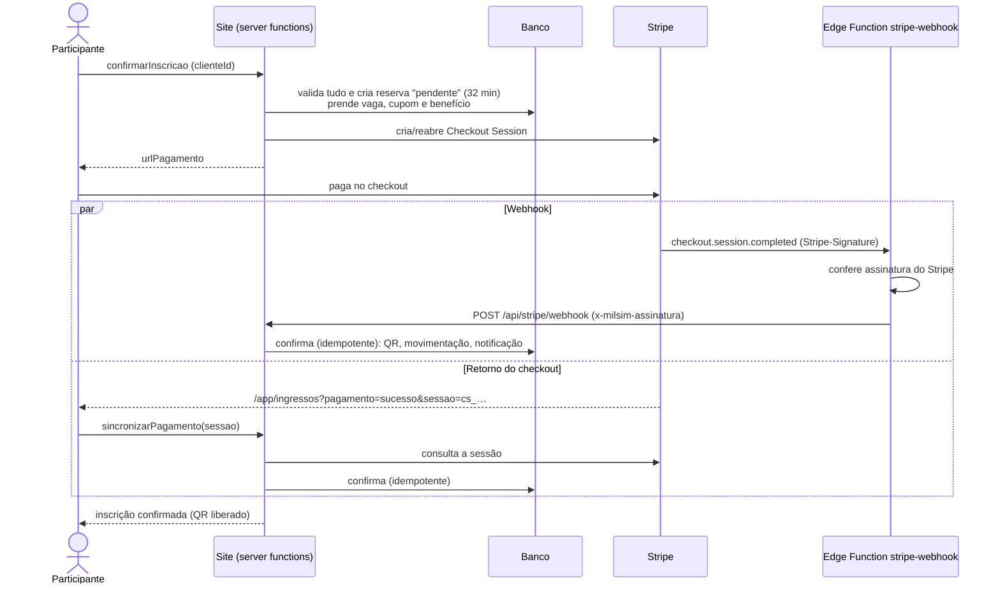
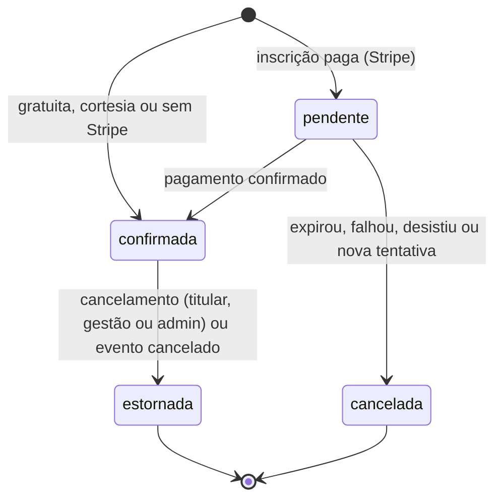
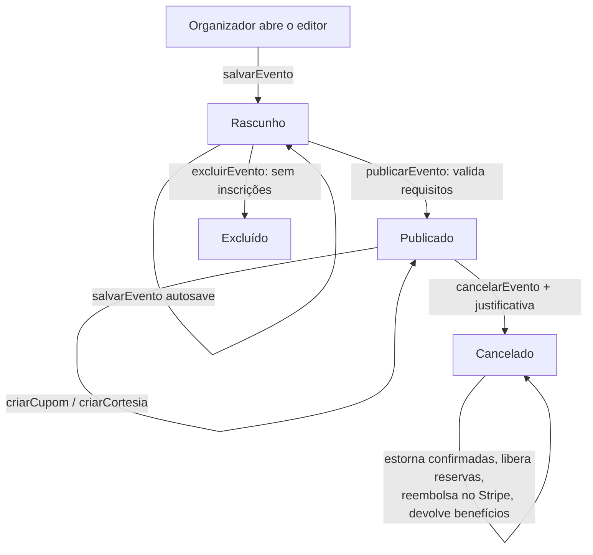
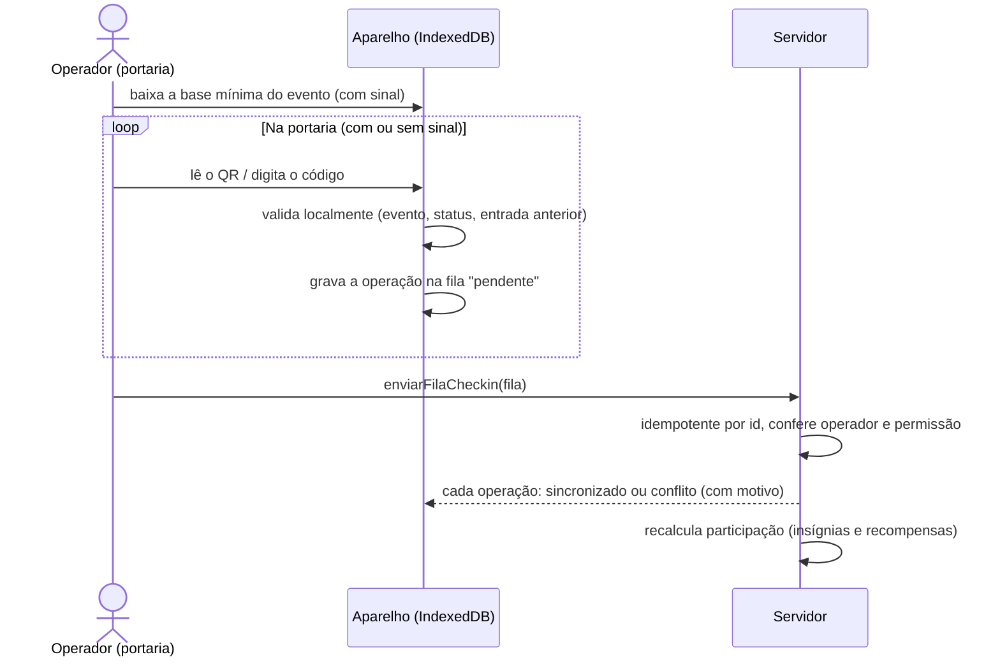
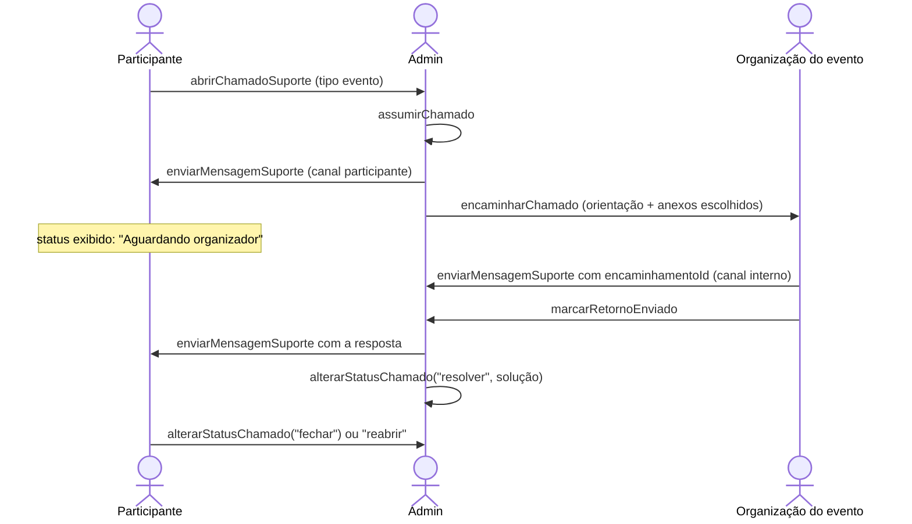
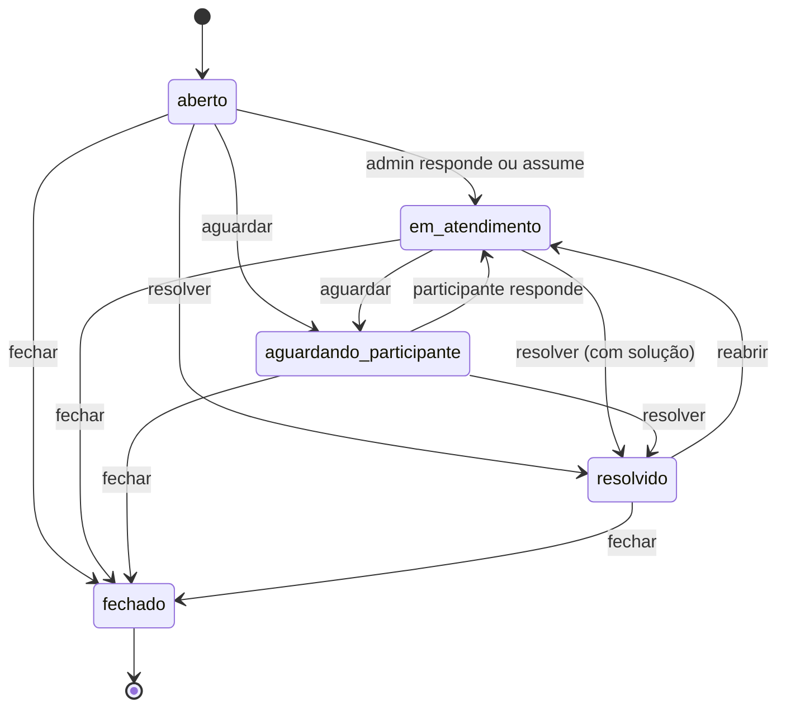
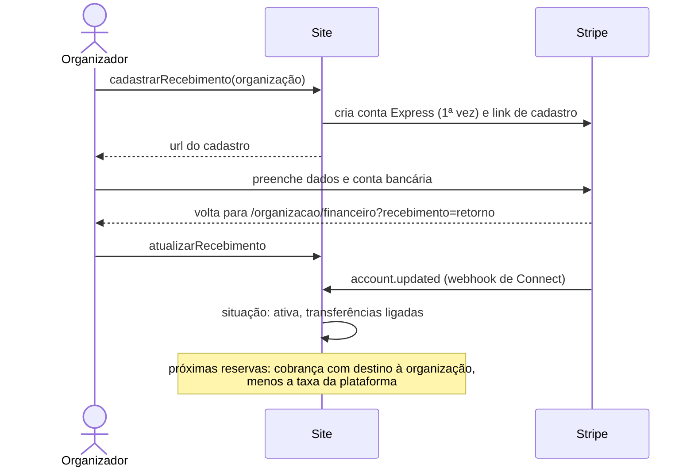
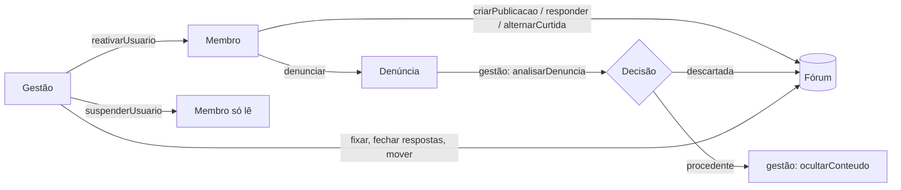

# Fluxos

[← Documentação](README.md) · [Regras de negócio](regras-de-negocio.md) · [APIs](api/README.md) · [Arquitetura](ARQUITETURA.md)

Os caminhos principais do sistema, ponta a ponta. Os diagramas usam Mermaid (o GitHub os desenha).
Os nomes nas setas são as APIs; cada uma tem sua página em [`docs/api/`](api/README.md).

## Sumário

1. [Toda escrita: unidade de trabalho](#1-toda-escrita-unidade-de-trabalho)
2. [Cadastro, login e organizador](#2-cadastro-login-e-organizador)
3. [Inscrição com pagamento (Stripe)](#3-inscrição-com-pagamento-stripe)
4. [Estados da inscrição](#4-estados-da-inscrição)
5. [Criar, publicar e cancelar um evento](#5-criar-publicar-e-cancelar-um-evento)
6. [Check-in offline](#6-check-in-offline)
7. [Suporte com encaminhamento](#7-suporte-com-encaminhamento)
8. [Repasse à organização (Stripe Connect)](#8-repasse-à-organização-stripe-connect)
9. [Comunidade e moderação](#9-comunidade-e-moderação)

---

## 1. Toda escrita: unidade de trabalho

Toda API que grava passa por `mutar` (`src/server/unidade.server.ts`). Detalhes em
[ARQUITETURA.md §3](ARQUITETURA.md#3-fluxo-de-uma-requisição).

## 2. Cadastro, login e organizador

- Login: [`entrar`](api/sessao/entrar.md); a sessão fica em cookies. Conta desativada é deslogada.
- Senha esquecida: [`recuperarSenha`](api/sessao/recuperarSenha.md) → e-mail em português →
  `/recuperar-senha?token_hash=…` → [`validarTokenRecuperacao`](api/sessao/validarTokenRecuperacao.md) →
  [`definirNovaSenha`](api/sessao/definirNovaSenha.md).

## 3. Inscrição com pagamento (Stripe)

Com `STRIPE_SECRET_KEY` configurada e valor a pagar. Sem Stripe ou sem valor, a inscrição é
confirmada direto no primeiro passo.

Desvios:
- **Desistiu ou o prazo acabou**: `checkout.session.expired` (ou a varredura, 10 min depois do
  prazo) libera a reserva; vaga, cupom e benefício voltam.
- **Pagamento assíncrono** (boleto): `completed` sem pagamento marca `processando` (a vaga continua
  presa) até `async_payment_succeeded` (confirma) ou `async_payment_failed` (libera).
- **Pagou tarde demais** e não há mais vaga: o pagamento é reembolsado automaticamente.
- **Voltar a pagar depois**: [`retomarPagamento`](api/inscricoes/retomarPagamento.md) reabre a mesma sessão.
- **Rede caiu no envio**: reenviar com o mesmo `clienteId` devolve a mesma reserva e o mesmo checkout.

## 4. Estados da inscrição

| Status | Ocupa vaga | QR de entrada | Entra no financeiro |
|---|---|---|---|
| `pendente` (reserva vigente) | sim | não | não (aparece em "reservas aguardando") |
| `confirmada` | sim | sim | sim |
| `cancelada` | não | não | não |
| `estornada` | não | não (invalidado) | sim, com o estorno |

## 5. Criar, publicar e cancelar um evento

- O editor (`src/components/editorEvento/`) tem 7 etapas: informações gerais (inclui o contato no
  WhatsApp), data e local, imagem, exércitos, ingressos e lotes, cronograma e regras, revisão.
- Rascunhos salvam sozinhos no servidor. Edições de evento publicado ficam no aparelho (IndexedDB)
  até "Salvar alterações", para não mudar a página pública antes da hora.

## 6. Check-in offline

## 7. Suporte com encaminhamento

## 8. Repasse à organização (Stripe Connect)

## 9. Comunidade e moderação

